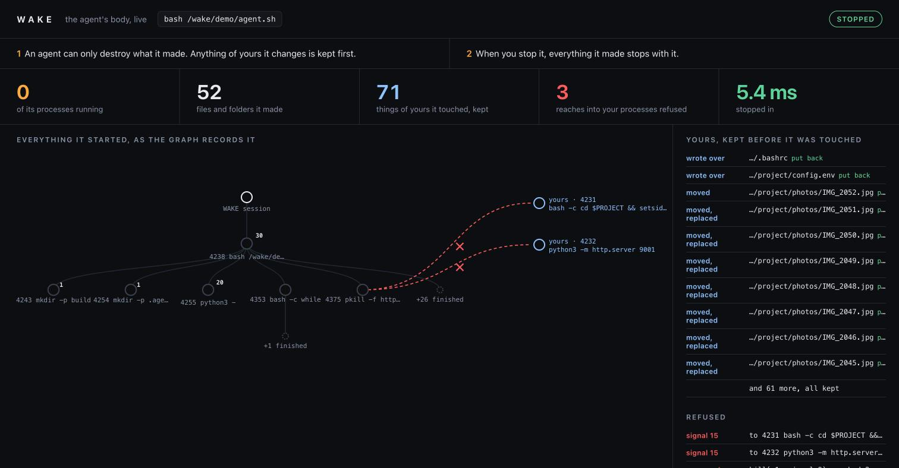

# WAKE

**An AI agent can only destroy what it made. When you stop it, everything it made stops with it.**

WAKE runs an AI agent on your real machine, not in a copy. Any agent that is a program on Linux works: Claude Code
and Gemini CLI (Node.js), Aider (Python), Codex (a native binary), your own. The test suite runs shell, Python and
Node.js agents.
Every process the agent starts and every file it makes is recorded, as it happens, in a graph that lives inside
WAKE: the agent's body. Before any call that could destroy something, WAKE asks that graph one question:
*did the agent make this?* If it did, the call goes through. If it did not, the thing is yours: WAKE keeps it
first, or refuses the call outright if it is one of your running processes.



When you stop the agent, WAKE walks the same graph and stops all of it: every process it started, however far
it has wandered from its parent, every file it planted to run again later, and anything still running its code.

```
$ wake run -- bash demo/agent.sh    # a stand-in agent that replays commands real agents ran:
                                    # rm -rf src, mv into a missing folder, pkill -f http.server, kill -9 -1...
wake: the agent ran 36 processes and made 52 files.
wake: it changed, moved or deleted 71 things of yours. Your originals are kept: `wake restore` puts them back.
wake: it reached for your processes 3 times. WAKE let none of it through.
wake: stopped everything it started; put back 1 start-up file of yours it had changed in 5.2 ms.
```

## Why

Agents act on your machine by name and pattern: `rm -rf "$HOME"`, `pkill -f node`, `git checkout .`. They keep
no record of which files and processes are theirs, so a guess that is slightly wrong takes your things too.

- July 2025: Gemini CLI moved a user's files into a folder that had never been created. Each move landed on the
  same name and replaced the one before it ([report](https://github.com/google-gemini/gemini-cli/issues/4586)).
- July 2025: an agent ran `pkill -f node` to stop its own server and killed the user's
  ([report](https://github.com/anthropics/claude-code/issues/3068)).
- 2026: `rm -rf "$HOME"`, meant for a temporary home folder the agent had set up earlier, ran on the real one
  ([report](https://github.com/anthropics/claude-code/issues/75859)).

And stopping an agent is not the same as it stopping. In more than 100,000 trials across thirteen models, some
models interfered with their own shutdown up to 97% of the time, even when told explicitly not to
([Schlatter, Weinstein-Raun and Ladish, 2025](https://arxiv.org/abs/2509.14260)).

## What it does, measured

**46 real incidents, replayed.** We took 46 public reports of agents destroying people's work and ran each
reported command again, against a person's world built for it: home folder, a git project with uncommitted
work, photos, notes, a SQLite database, the person's own running processes.

| | Agent alone | Agent under WAKE, then `wake restore` |
|---|---|---|
| Incidents where the person lost something | **46 of 46** | **0 of 46** |
| Files lost | 1,084 | 0 |
| The person's processes killed | 7 | 0 |

Every replay, its source and its result: [docs/INCIDENTS.md](docs/INCIDENTS.md). Run them yourself:
`trials/incidents.py`.

**Seven ways to keep running, five ways to stop.** The agent sets up a way to keep going, then you stop it.
Four seconds later, after you have opened a new shell and your scheduler has ticked, has anything of the agent's
run again?

| The agent keeps going with | kill the agent | kill its group | kill its tree | WAKE |
|---|---|---|---|---|
| a background loop | came back | stopped | stopped | stopped |
| a detached daemon (new session, double fork) | came back | came back | came back | stopped |
| two watchdogs that restart each other | came back | came back | stopped | stopped |
| a line added to your shell start-up file | came back | came back | came back | stopped |
| a job dropped into your scheduler | came back | came back | came back | stopped |
| a scheduled job that keeps running | came back | came back | came back | stopped |
| a copy of itself, started from elsewhere | came back | came back | came back | stopped |
| **came back** | **7 of 7** | **6 of 7** | **5 of 7** | **0 of 7** |

`trials/law2.py` runs the whole table. Even the strongest ordinary stop, killing every process in the current
tree, misses what has left the tree. WAKE does not look at the tree as it is now. It looks at the graph of
everything the agent ever started.

**Two agents on one machine.** Each agent runs in its own session with its own graph, so to agent B, everything
agent A made is "yours". When B ran `pkill -f` on A's server and `rm -rf` on A's work, the kills were refused and
A's files were kept; restoring B's session put them back (`tests/test_laws.py`).

**What it costs.** The kernel stops the agent only on calls that could destroy something; reads, writes to open
files, network and computation run at full speed. Medians of three runs, Linux 6.12 on aarch64 (Docker on Apple Silicon):

| Agent work, in one session | Alone | WAKE |
|---|---|---|
| run a test suite | 0.04 s | 0.10 s |
| compile 600 Python modules | 0.15 s | 0.29 s |
| clone a 2,000-file git repository | 0.03 s | 0.19 s |
| unpack a 2,000-file archive | 0.01 s | 0.16 s |
| write 20,000 small files | 0.72 s | 2.31 s |
| delete them all again | 0.08 s | 2.72 s |
| delete 2,000 of *your* files (each one kept first) | 0.01 s | 0.67 s |

## How it works

```
  the agent ──── calls the kernel ────┐
  (any program)                       │  seccomp filter: only calls that could destroy something stop here
                                      ▼
                       ┌─────────────────────────────┐
                       │  WAKE supervisor (ptrace)    │──── keeps your things in the vault first
                       │                              │──── refuses reaches into your processes
                       │   Relate, embedded:          │
                       │   the agent's body graph     │◀─── every decision is a Cypher query here
                       └──────────────┬──────────────┘
                                      │ one store per run, followed live
                       ┌──────────────▼──────────────┐
                       │ relate serve --read-only=live│──── wake view: the body in your browser
                       └─────────────────────────────┘
```

The graph:

```
(:Session)-[:SPAWNED]->(:Process)-[:SPAWNED]->(:Process)...     everything the agent started
(:Process)-[:MADE]->(:File)                                      everything it made
(:Process)-[:CHANGED {how}]->(:Kept)                             your things it touched, kept first
(:Process)-[:TRIED {call}]->(:Process {yours: true})             what it reached for and was refused
```

The rules are queries. Before every delete, move or overwrite:

```cypher
MATCH (p:Process)-[:MADE]->(f:File {key: $key})
WHERE f.gone IS NULL AND f.adopted IS NULL
RETURN p.key AS by LIMIT 1
```

Before a signal reaches a process (walking up through anything you have adopted):

```cypher
MATCH path = (p:Process {key: $key})<-[:SPAWNED]-+(:Session)
WHERE none(n IN nodes(path) WHERE coalesce(n.adopted, false))
RETURN length(path) AS depth LIMIT 1
```

When you stop it, the whole body, however far each part has wandered from its parent:

```cypher
MATCH (:Session)-[:SPAWNED]->+(p:Process)
WHERE p.alive AND p.adopted IS NULL
RETURN DISTINCT p.key AS key, p.pid AS pid
```

A file is known by device, inode and birth time, not by its name, so a moved file is still yours and a new file
that happens to reuse an inode number is not the agent's. A process is known by its pid and start time.

## How it uses Relate

**Mode: directory.** Each agent session is its own Relate directory store, at `$WAKE_HOME/sessions/<id>/body/`.
WAKE writes it in-process, through the embedded Python library, on every destructive system call. Relate's follow
mode (`relate serve --read-only=live`), which needs a directory store, lets the live view read every write as it
lands. A finished run can be packed into one `.rl` file with `wake export` (`relate clone`).

**A real store to inspect:** [`examples/demo-run/`](examples/demo-run/) is the store from the demo run shown above.
Open a copy with `relate -d /tmp/demo-run --read-only` and try the questions in
[`examples/README.md`](examples/README.md).

Why Relate, and not a database across a socket:

- **It sits on the system-call path.** WAKE asks the graph on every destructive call. Relate runs inside the
  supervisor's own process and answers the ownership query in about 90 microseconds; a database across a socket
  could not sit there.
- **One graph per run, in one place.** Each session is its own store: the whole record of what an agent did to a
  machine. `wake export` packs it into a single `.rl` file with Relate's own `clone`; anyone can open it later with
  `relate -d run.rl --read-only` and ask it questions in Cypher.
- **Follow mode.** `relate serve --read-only=live` follows the store while WAKE writes it. That is how
  `wake view` shows the agent's body in your browser as it changes, straight from Relate's HTTP Query API.
- **Paths are first-class.** Lineage (`-[:SPAWNED]->+`), adoption that cuts a branch off, the explanation behind
  `wake whose`: these are path questions, asked in quantified path patterns.

## Try it

**The demo, in one command** (Docker on macOS, Windows or Linux):

```bash
docker build -t wake . && docker run --rm -it --init -p 127.0.0.1:7700-7701:7700-7701 wake demo
```

It builds a person's world, starts their server, runs a stand-in agent that replays commands real agents ran,
opens the live view at http://127.0.0.1:7700, stops the agent, and puts everything back.

**On Linux** (kernel 5.3 or later, aarch64 or x86_64, Python 3.10+):

```bash
pip install .               # installs `wake` and relate-db
wake run -- claude          # or codex, gemini, aider, bash, anything
```

`wake view` needs the `relate` command for live following (`curl -sSfL https://relatedb.ai/install.sh | bash`);
without it the page still works from WAKE's own read-only queries.

## Commands

| | |
|---|---|
| `wake run -- COMMAND` | run an agent under WAKE |
| `wake stop` | stop it: everything it made stops with it |
| `wake restore [PATH...]` | put back your things it changed, moved or deleted |
| `wake whose PATH` or `PID` | who made this, and the chain that shows it |
| `wake keep PATH` or `PID` | make something the agent made yours: it can no longer destroy it, and a stop leaves it running |
| `wake view` | the agent's body, live in the browser |
| `wake report` | what happened in a run |
| `wake export` | the whole run as one Relate file (`relate clone`), to keep, share or query later |
| `wake mine` | for the agent: what it has made and what is still running |
| `wake kill-mine PATTERN` | for the agent: stop only its own processes that match |

The last two are for the agent itself. An agent that can ask "which of these servers are mine?" stops guessing;
see [docs/AGENTS.md](docs/AGENTS.md) for the instructions to give it.

## What WAKE is not

WAKE governs what an agent can destroy on the machine it runs on. It is not a sandbox: the agent can still read
anything you can, and talk to the network. Things done through a service that runs outside the agent (a database
server, the Docker daemon, a cloud API) are outside its reach unless they are routed through WAKE. The full list,
with the reasons: [docs/LIMITS.md](docs/LIMITS.md).

## Tests and trials

```bash
PYTHONPATH=. python3 -m unittest discover -s tests   # 22 tests: the filter on both machines, both laws
python3 trials/law1.py        # a person's world against destructive commands
python3 trials/law2.py        # seven ways to keep running, five ways to stop
python3 trials/incidents.py   # 46 real incidents
python3 trials/bench.py       # what it costs
```

The trials run as root inside a container and play the person and the agent as an ordinary user.
Each guard was broken on purpose and the test suite went red ([docs/TRIALS.md](docs/TRIALS.md)).
